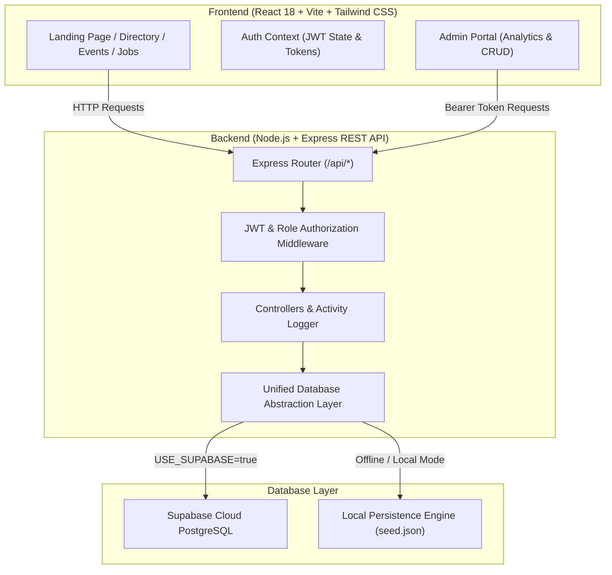
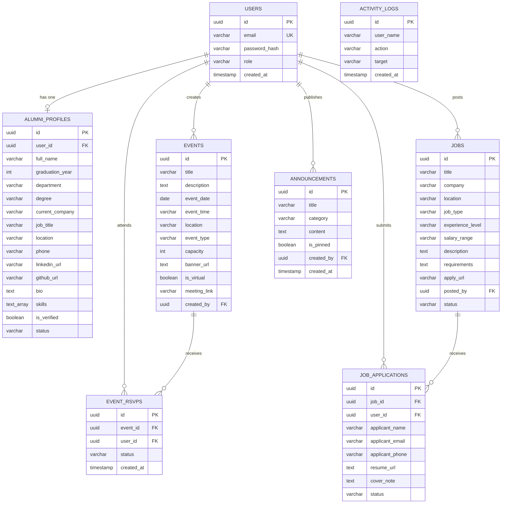

# 🎓 AlumniConnect — College Alumni Management System

[](https://nodejs.org/)
[](https://react.dev/)
[](https://tailwindcss.com/)
[](https://supabase.com/)
[](LICENSE)

> A modern, full-stack web application designed for engineering colleges and universities to connect graduates, manage alumni records, track placement analytics, schedule reunions, and share career opportunities.

---

## 📌 Project Abstract

Higher educational institutions face significant challenges in tracking graduate outcomes, maintaining updated alumni contact directories, organizing reunions, and facilitating mentorship for current students. Traditional approaches relying on disjointed spreadsheets or physical registers lead to data obsolescence and missed networking opportunities.

**AlumniConnect** is an enterprise-grade, role-based Alumni Management System built with **React, Vite, Tailwind CSS, Node.js, Express, and Supabase PostgreSQL**. It provides a unified platform where college administrators can monitor department-wise distribution, analyze graduation batch trends, perform full CRUD operations on alumni profiles, and broadcast campus notices. Alumni can manage their professional profiles, search through a verified global directory, RSVP for college reunions with a single click, and share job openings directly with their alma mater.

---

# 🎓 AlumniConnect — Alumni Management System

A full-stack Alumni Management System for connecting graduates, managing alumni profiles, organizing college events, and sharing career opportunities.

## ✨ Features

- Alumni registration and login
- Alumni dashboard and profile management
- College events and registrations
- Career and job opportunities
- Responsive user interface

## 🛠️ Technologies Used

- Frontend: React, HTML, CSS, JavaScript
- Backend: Node.js, Express
- Database: Add your actual database technology here

## 🚀 How to Run

1. Clone this repository.
2. Install dependencies.
3. Configure environment variables.
4. Start the backend and frontend.
5. Open the local application URL.

See the project setup instructions for details.

## 🎯 Objectives & Scope

1. **Centralized Alumni Database**: Replace manual records with a structured PostgreSQL database maintaining verified alumni identities, departments, graduation years, and career history.
2. **Real-Time Analytics & Reporting**: Provide college administrators with interactive charts for branch-wise distribution, batch counts, employment rates, and instant CSV/JSON exports for accreditation (NAAC/NBA).
3. **Alumni Engagement & Networking**: Enable graduates to search and discover peers by company, skill set, branch, or batch, and connect via LinkedIn/GitHub.
4. **Events & Reunions**: Centralize event management for campus homecomings, technical webinars, guest lectures, and track RSVPs in real time.
5. **Career Referrals & Job Board**: Empower alumni working at tier-1 corporations to post vacancies and allow alumni/students to submit direct applications.

---

## 💻 Technology Stack

| Layer | Technology | Purpose |
| :--- | :--- | :--- |
| **Frontend UI** | React 18, Vite | High-performance SPA with fast HMR |
| **Styling** | Tailwind CSS 3.4 | Modern college-branded responsive design |
| **Icons** | Lucide React | Clean, accessible vector iconography |
| **Routing** | React Router v7 | Client-side routing with role-based Route Guards |
| **HTTP Client** | Axios | Request interceptors, JWT bearer token injection |
| **Backend API** | Node.js, Express | RESTful architecture, middleware, audit logging |
| **Authentication** | JWT & Bcrypt.js | Cryptographic password hashing and token validation |
| **Primary Database** | Supabase PostgreSQL | Cloud relational database with foreign keys & indexes |
| **Fallback Engine** | Resilient JSON Store | Zero-config standalone offline engine for instant demos |

---

## 🏛️ System Architecture



---

## 🗄️ Database Design (Entity-Relationship)



---

## ✨ Key Features & Capabilities

### 1. 🛡️ Role-Based Authentication & Security
- **Dual Role System**: Separate interfaces and permissions for `admin` (College Authorities) and `alumni` (Graduates).
- **JWT Protection**: Secured bearer tokens with customizable expiration.
- **Password Encryption**: Passwords salted and hashed with `bcryptjs` (cost factor 10).
- **Quick Demo Autofill**: One-click demo credentials directly on the login screen for seamless mini project evaluation.

### 2. 📊 College Administrator Dashboard
- **Executive Metrics**: Total alumni, verified accounts count, employment rate percentage, and active career listings.
- **Department Distribution Chart**: Real-time breakdown across Computer Science, IT, ECE, Mechanical, Civil, and Electrical branches.
- **Graduation Batch Trends**: Bar chart visualizing alumni counts from 2018 to 2025.
- **Top Hiring Companies**: Live leaderboard of organizations hiring college talent (Google, Microsoft, AWS, Tesla, Qualcomm, Zomato).
- **Audit Activity Trail**: Real-time log of administrative and alumni operations.
- **Alumni Management Table (CRUD)**:
  - Add new alumni records manually.
  - Search by name, company, job title, skills, or location.
  - Filter by Department, Batch, and Status.
  - Edit alumni details in place.
  - Verify and toggle status (Active / Inactive / Pending).
  - Permanent record deletion with safety confirmation.
  - **1-Click CSV Export**: Download complete alumni roster formatted for college accreditation.

### 3. 🎓 Alumni Portal & Directory
- **Personal Profile Management**: Update current company, designation, city, skills, bio, LinkedIn, and GitHub links.
- **Searchable Alumni Directory**: Discover batchmates and senior alumni with filter pills.
- **1-Click Event RSVP**: Confirm attendance to college reunions, webinars, and networking galas with dynamic attendee counting.
- **Career Hub & Referrals**:
  - Browse open roles filtered by Full-time, Internship, Remote, or Part-time.
  - Post new job openings to hire from your college.
  - Easy Apply modal with cover note and portfolio/resume URL submission.

### 4. 📢 College Bulletins & Notice Board
- Priority pinned announcements for campus news, alumni endowment milestones, and scholarship felicitations.

---

## 🚀 Quick Start Guide (Run Locally in 60 Seconds)

### Prerequisites
- [Node.js](https://nodejs.org/) v18.x or v20.x installed.

### 1. Start the Application
From the project root directory, run:

```bash
# Start the unified backend and frontend
npm start
```

Open your browser and navigate to:
👉 **[http://localhost:5000](http://localhost:5000)**

*(The backend automatically serves both the REST API and the production React frontend simultaneously!)*

### Alternatively, Run in Split Development Mode:
```bash
# Terminal 1 - Start Backend API (Port 5000)
npm run server

# Terminal 2 - Start Frontend Vite Dev Server (Port 5173)
npm run client
```

---

## 🔑 Demo Credentials for Viva / Presentation

| Role | Email Address | Password | Privileges |
| :--- | :--- | :--- | :--- |
| **College Admin** | `admin@alumni.edu` | `admin123` | Full dashboard, CRUD alumni, schedule events, post jobs, broadcast notices, CSV export |
| **Alumni Member** | `rahul.sharma@alumni.edu` | `alumni123` | Personal profile edit, alumni directory search, 1-click event RSVP, job applications |

*(You can also click the "Admin Demo" or "Alumni Demo" buttons directly on the Login page to autofill these credentials instantly!)*

---

## 🧪 Automated Test Suite

A comprehensive test suite is included to verify all REST endpoints, authentication, and database operations:

```bash
node server/test_all_features.js
```

**Test Output:**
```
====================================================
🧪 Starting Full-Stack AlumniConnect End-to-End Tests
====================================================
✅ [PASS] Health Check endpoint /api/health
✅ [PASS] Public Statistics /api/stats/public
✅ [PASS] Get Alumni Directory /api/alumni
✅ [PASS] Alumni Login authentication
✅ [PASS] Verify current user /api/auth/me
✅ [PASS] Admin Login authentication
✅ [PASS] Admin Dashboard Stats & Charts Data
✅ [PASS] CRUD Create: Add new alumni record
✅ [PASS] CRUD Update: Update alumni details
✅ [PASS] CRUD Status Toggle: Verify & Activate alumni
✅ [PASS] Events: Create college event
✅ [PASS] Events: Alumni 1-Click RSVP toggle
✅ [PASS] Careers: Post job opportunity
✅ [PASS] Careers: Submit job application
✅ [PASS] Announcements: Broadcast notice
✅ [PASS] CRUD Delete: Delete test alumni record
✅ [PASS] Events: Delete test event
✅ [PASS] Careers: Delete test job
✅ [PASS] Announcements: Delete test announcement
====================================================
🎉 TEST SUMMARY: 19 Passed, 0 Failed
====================================================
```

---

## ☁️ Connecting Supabase PostgreSQL

The application runs in offline-resilient local mode by default. To connect your live Supabase cloud database:

1. Create a free project at [supabase.com](https://supabase.com).
2. Go to your Supabase Project **SQL Editor**:
   - Copy and paste the contents of `server/database/supabase_schema.sql` and click **Run**.
   - Copy and paste the contents of `server/database/supabase_seed.sql` and click **Run**.
3. Open `server/.env` and add your credentials:
   ```env
   USE_SUPABASE=true
   SUPABASE_URL=https://your-project-id.supabase.co
   SUPABASE_ANON_KEY=your-supabase-anon-key
   SUPABASE_SERVICE_ROLE_KEY=your-supabase-service-role-key
   ```
4. Verify your connection:
   ```bash
   npm run test:supabase
   ```

---

## 🌐 Production Deployment Guide

### Option 1: Vercel (Frontend) + Render (Backend)

#### Step 1: Deploy Backend to Render
1. Sign up at [render.com](https://render.com).
2. Create a **New Web Service** pointing to the `server/` folder of this repository.
3. Configure settings:
   - **Environment**: `Node`
   - **Build Command**: `npm install`
   - **Start Command**: `npm start`
4. Add Environment Variables:
   - `NODE_ENV`: `production`
   - `JWT_SECRET`: `your_random_secure_jwt_secret`
   - `USE_SUPABASE`: `true` (if using Supabase) or `false`
   - `SUPABASE_URL` and `SUPABASE_ANON_KEY` (if using Supabase)
5. Render will assign you a backend URL like `https://alumniconnect-api.onrender.com`.

#### Step 2: Deploy Frontend to Vercel
1. Sign up at [vercel.com](https://vercel.com).
2. Click **Add New Project** and import the `client/` folder.
3. Framework Preset: **Vite**.
4. Add Environment Variable:
   - `VITE_API_URL`: `https://alumniconnect-api.onrender.com/api`
5. Click **Deploy**. Vercel will build and assign your live public website URL (e.g., `https://alumniconnect.vercel.app`).

---

## 📋 Viva Demonstration Walkthrough (5-Minute Guide)

When presenting this project to your college viva examiners:

1. **Introduction & Landing Page (1 min)**:
   - Open `http://localhost:5000`.
   - Point out the college branding, live metrics counter, official campus notices, and alumni spotlight cards.
2. **Admin Portal Demonstration (2 min)**:
   - Click **Sign In** -> Click **Admin Demo** (`admin@alumni.edu`).
   - Highlight the **Department-wise Alumni Distribution** and **Graduation Batch Trends** charts.
   - Go to **Manage Alumni**: Demonstrate search, department filtering, and click **Export CSV** to show that data can be exported for college documentation.
   - Click **Add New Alumni**: Fill in a new record to demonstrate CRUD functionality live.
   - Show how changing a record's status from *Active* to *Inactive* or *Verified* works instantly.
3. **Alumni Experience (1.5 min)**:
   - Sign out and click **Alumni Demo** (`rahul.sharma@alumni.edu`).
   - Show the personalized welcome banner with graduation batch.
   - Open **Events**: Click **RSVP Now** on an upcoming reunion and point out the attendee counter incrementing.
   - Open **Careers**: Show how alumni can post a job opening and apply to existing positions.
   - Open **Alumni Directory**: Demonstrate filtering by batch and technical skills.
4. **Architecture & Code Defense (30 sec)**:
   - Mention the clean separation between React SPA, Express REST APIs, JWT authentication, and Supabase PostgreSQL schema with primary and foreign key constraints.

---

## 📄 License
This project is open-source and available under the **MIT License**. Created for academic evaluation and college mini project presentation.
